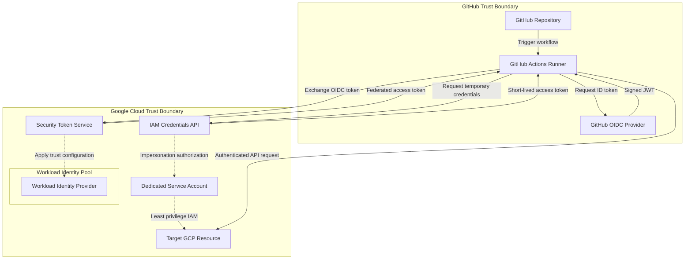

# Security Architecture

**Status:** Proposed architecture — implementation pending.

## Overview

This project demonstrates keyless authentication between GitHub Actions and Google Cloud using OpenID Connect (OIDC) and Workload Identity Federation (WIF). The objective is to eliminate stored long-lived cloud credentials while enforcing explicit trust boundaries and least privilege authorization.

## Architecture Diagram

Solid arrows represent requests and responses; dashed arrows represent logical configuration and authorization relationships.

## Authentication Flow

1. GitHub Actions starts an authorized workflow with `id-token: write` permission.
2. The runner requests a signed OIDC token from GitHub.
3. The runner submits the token to Google Cloud STS.
4. STS validates the token against the Workload Identity Provider configuration, including issuer, audience, signature, expiration and attribute conditions.
5. STS issues a federated access token if validation succeeds.
6. The runner requests service account impersonation through the IAM Credentials API.
7. Temporary service account credentials are issued if impersonation is authorized.
8. The runner accesses the target resource within the assigned IAM permissions.

## Security Controls

| Planned control | Security objective |
|---|---|
| OIDC federation | Eliminate stored long-lived cloud keys |
| Attribute conditions | Restrict trusted external identities |
| Repository ID validation | Reject unauthorized repositories |
| Owner ID validation | Restrict the trusted repository owner |
| Branch restriction | Limit authentication to approved branches |
| Event restriction | Limit eligible workflow triggers |
| Service account impersonation | Control access to GCP identities |
| Least privilege IAM | Minimize the blast radius |
| Short-lived credentials | Limit credential exposure duration |
| Branch protection | Reduce unauthorized workflow changes |

## Trust Boundaries

### GitHub

Responsible for workflow execution, workload identity issuance, repository security and workflow permissions.

### Google Cloud

Responsible for external token validation, identity federation, service account impersonation and resource-level authorization.

## Infrastructure as Code

Terraform will manage:

- Workload Identity Pool and Provider
- Dedicated service account
- Attribute mappings and conditions
- IAM bindings
- Demonstration resources

The initial infrastructure bootstrap will use a separate administrative identity. The runtime service account will not be granted administrative access merely to bootstrap its own trust configuration.

## Residual Risks

- Compromised authorized workflows
- Malicious third-party GitHub Actions
- Excessive IAM permissions
- Incorrect attribute conditions
- Temporary credential theft
- Terraform state exposure

These risks will be addressed through security hardening, threat modeling and negative security testing.

## Design Limitations

Service account impersonation is the selected initial design. The target GCP resource and exact IAM permissions remain to be finalized. No cloud infrastructure has been deployed and the controls have not yet been validated.
